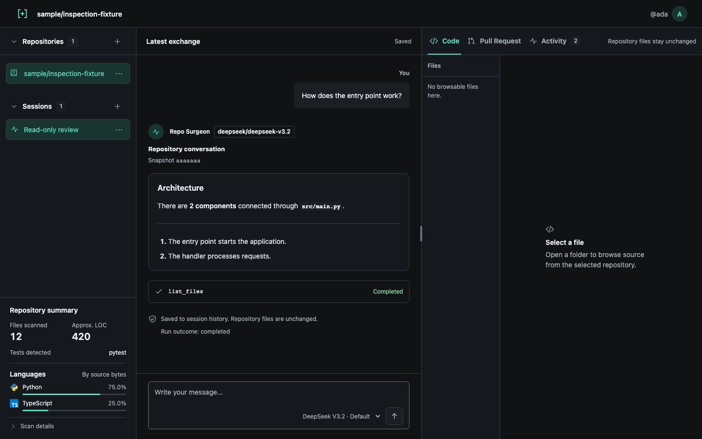
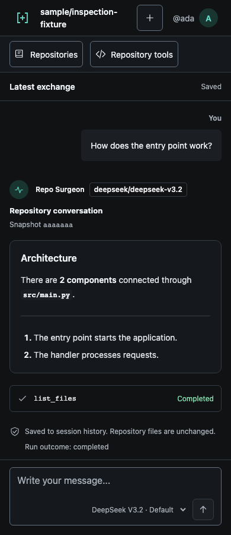
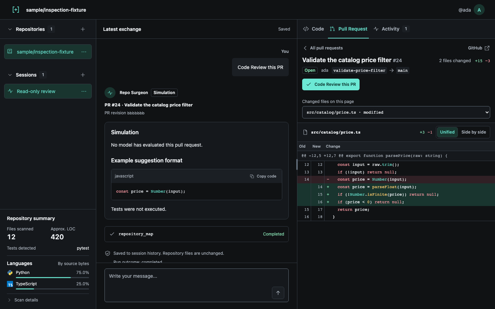
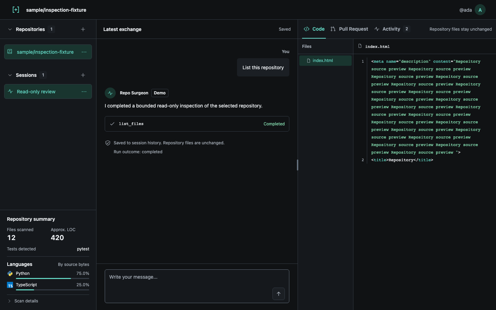

# Live PR reviews and model selection

Validated 2026-11-18. The compact composer places a PR model selector immediately left of a rounded-square upward-arrow send button. The input starts empty with Write your message..., grows from one line to 180px and shrinks when cleared. Ordinary questions use the same selected model as PR reviews. Responses center at up to 96ch, use lighter body text, stronger Markdown emphasis and prose numbers, and faint hairline separators.

The composer selects DeepSeek V3.2 (default) or DeepSeek V4 Flash (budget) for the next PR review. The server accepts only those IDs, applies separate routing price caps and preserves the selected model and returned usage in saved review metadata. The existing single-request, bounded-context and strict provider privacy policies remain in force. There is no automatic inference retry or model fallback.

## Evidence

- Backend: Ruff formatting/checks, mypy and 232 passing tests. One optional PostgreSQL registration integration test skipped because its separate test database URL was unset. The live review below exercised the existing PostgreSQL database without resetting data.
- Frontend: Prettier, ESLint, TypeScript, 46 unit tests, 74 Playwright browser tests and production build passed.
- Browser selection sends the chosen budget ID; HTTP 429 appears as an error. Existing streaming, stop, Markdown safety, copy, restored context and mobile review tests remain green.
- Backend tests exercise both model requests and their caps, reject an arbitrary model before context preparation, and reject changing the model while reusing a request identity.
- Manual live V4 Flash synthetic review: 325 input and 512 output tokens, reported cost $0.00012141. It identified the intentionally unsafe parseInt validation. The deliberately small output budget reached its limit.
- Manual live V3.2 review through the running application: 5,758 input and 870 output tokens, reported cost $0.00182768. The run completed and its saved answer restored exactly from PostgreSQL. It used a separate session titled “Live model review check” with a random suffix.
- A separate 53-token V3.2 diagnostic completed for $0.00001798. An earlier request returned HTTP 429. Availability is provider-dependent; failures retain their explicit error and never become simulated success.

Costs are the usage values returned by OpenRouter, not a guarantee of future prices or a quality benchmark. No paid inference is part of the automated suite. Private source, credentials, PR descriptions and model responses are excluded from this committed record.

## Captures

These are synthetic fixture accounts and repositories, captured by Playwright. The selector uses the existing theme tokens. Updated captures show the dark palette and synthetic ordinary-message responses.

## Test locally

1. Start the existing database, backend and frontend using the normal private environment files. Set `REPO_SURGEON_REVIEW_MODE=openrouter` and the backend-only API key. Remove any process-level simulation override and restart the backend.
2. Open the workspace and choose a model in **PR review model**. Changing it makes no inference call.
3. Open **Pull Request**, select a PR and click **Code Review this PR**. This action sends bounded PR context to OpenRouter and incurs usage.
4. Confirm progress, streamed Markdown and code copying; reload the session to see the persisted answer and model. Stop review cancels an in-progress connection.
5. Ask a normal repository question in the composer and follow up on its answer. This uses saved-snapshot excerpts and recent exchanges. PR review remains a separate pinned-revision action. Use explicit simulation mode for free interface testing.

## Repository-chat validation

The authenticated application test sends arbitrary repository questions, checks model selection, CSRF and ownership failures, verifies question-sensitive replay protection and confirms that a follow-up receives the previous exchange. The repository snapshot remains unchanged. Browser coverage checks one-line input growth/shrinkage, empty-message protection, a rounded-square icon-only send button, ordinary answer streaming/restoration, and wrapped code with aligned line numbers.

A live V4 Flash repository question through the running application completed with 15,024 input and 430 output tokens, reported cost $0.0015340934. Its answer restored exactly from PostgreSQL. The check used its own “Repository chat check” session; no source or answer is published here.

